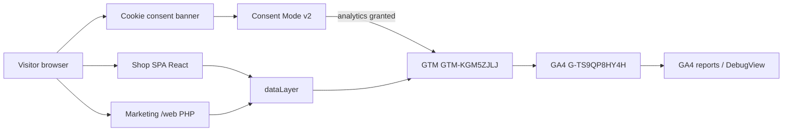

# Architecture

**Last reviewed:** 2026-11-11

## Stack responsibilities

| Layer | Tech | Role |
|-------|------|------|
| Shop API / HTML shell | Laravel (Docker `serra-prod`) | Serves SPA shell (`welcome.blade.php`), injects `window.__SERRA_ANALYTICS__` from `config/analytics.php` |
| Shop UI | React + Vite + React Router | Consent banner, GTM loader, `dataLayer` events, SPA `serra_page_view` |
| Marketing | Static PHP-FPM + nginx (`serra-static`) under `/web/` | Shared consent key, GTM loader after accept; **no** `serra_page_view` pushes |
| Tag routing | GTM `GTM-KGM5ZJLJ` | Maps dataLayer → GA4 tags with Consent Mode |
| Measurement | GA4 `G-TS9QP8HY4H` | Collection and reports |

Why GTM instead of many site snippets: one loader, consent-gated tags, ecommerce mapping without shipping a second `gtag.js` config in HTML.

## Diagram

## Lifecycle

**Visitor → Consent → GTM init → dataLayer events → GTM tags → GA4 → Reporting**

| Phase | Behavior (from code) |
|-------|----------------------|
| Before consent | Head sets `consent default` with `analytics_storage: denied` (and ads denied). GTM script is **not** injected. |
| Accept analytics | `consent update` → granted for `analytics_storage`; `ensureGtmLoaded` / marketing `ensureGtm` injects one `gtm.js?id=GTM-KGM5ZJLJ`. |
| Reject optional | Consent stored with `analytics: false`; update keeps analytics denied; GTM not loaded. |
| Withdraw later | Banner can reopen (`serra:open-cookie-settings` / marketing `data-serra-cookie-settings`). Update to denied; GTM script may remain in DOM but tags require `analytics_storage` (operator-confirmed on published tags). |
| SPA navigation | `AnalyticsRouteTracker` calls `trackPageView` → `serra_page_view` (skipped for `/admin*`; skipped if no analytics consent). |
| Ecommerce | Page/context hooks call `resources/js/analytics/ecommerce.js` helpers → `pushEcommerceEvent`. |

## Key source paths

| Path | Purpose |
|------|---------|
| `config/analytics.php` | `enabled`, `gtm_container_id`, `ga4_measurement_id` |
| `resources/views/welcome.blade.php` | Boot object + consent default/update |
| `resources/js/analytics/gtmLoader.js` | `initConsentMode`, `ensureGtmLoaded`, `applyAnalyticsConsent` |
| `resources/js/analytics/dataLayer.js` | `pushDataLayer`, consent helpers, ecommerce clear pattern |
| `resources/js/analytics/consentStorage.js` | `cookie_consent_v2` |
| `resources/js/analytics/ecommerce.js` | All shop event helpers |
| `resources/js/analytics/AnalyticsRouteTracker.jsx` | SPA page views |
| `resources/js/components/CookieConsentBanner.jsx` | Shop banner UX |
| `static-site/www/php/analytics.php` | Marketing boot |
| `static-site/www/js/serra-analytics.js` | Marketing banner + GTM load |

## Environment variables

Shop (`/srv/serra/prod/.env`, not in git):

- `ANALYTICS_ENABLED` → `config('analytics.enabled')`
- `GTM_CONTAINER_ID`
- `GA4_MEASUREMENT_ID` (documentation / boot only; site does not load parallel gtag config)

Marketing (`.env.static`):

- `STATIC_ANALYTICS_ENABLED`
- `STATIC_GTM_CONTAINER_ID`
- `STATIC_GA4_MEASUREMENT_ID`
